  

 

  
  &nbsp;
  

 

  <a href="#sobre-mim">Sobre mim</a>
  &nbsp; · &nbsp;
  <a href="#tecnologias">Tecnologias</a>
  &nbsp; · &nbsp;
  <a href="#contribuições">Contribuições</a>
  &nbsp; · &nbsp;
  <a href="#vamos-conversar">Contato</a>

 

## Sobre mim

Sou **Lucas Bitencourt** e meu foco é o **desenvolvimento front-end**. Gosto de transformar ideias em experiências simples, funcionais e bem construídas, na **web e no mobile**.

- **Formação:** Técnico em Informática pela **FIEB**; cursando **Análise e Desenvolvimento de Sistemas**.
- **Na prática:** aplicações com **React e Flutter**, além de experiência com Java e Spring Boot.
- **Minha base:** lógica de programação, orientação a objetos, Git, GitHub e metodologias ágeis.

> Aprendendo, errando, fazendo e evoluindo — uma linha de código de cada vez.

 

## Tecnologias

<table>
  <thead>
    <tr>
      <th align="center" width="33%">Front-end</th>
      <th align="center" width="33%">Mobile</th>
      <th align="center" width="33%">Back-end &amp; dados</th>
    </tr>
  </thead>
  <tbody>
    <tr>
      <td align="center" valign="top">
         
        
        &nbsp;
        
        &nbsp;
        
        &nbsp;
        
          
        HTML · CSS · JavaScript · React
          
      </td>
      <td align="center" valign="top">
         
        
        &nbsp;
        
          
        Dart · Flutter
          
      </td>
      <td align="center" valign="top">
         
        
        &nbsp;
        
        &nbsp;
        
          
        Java · Spring Boot · SQL Server
          
      </td>
    </tr>
  </tbody>
</table>

  FERRAMENTAS &amp; PRÁTICAS
    
  
  &nbsp;
  
  &nbsp;
  

 

## Contribuições

Um pouco do meu ritmo por aqui, com uma dose de nostalgia.

  <picture>
    <source media="(prefers-color-scheme: dark)" srcset="https://raw.githubusercontent.com/Lkzin0122/Lkzin0122/output/pacman-contribution-graph-dark.svg" />
    <source media="(prefers-color-scheme: light)" srcset="https://raw.githubusercontent.com/Lkzin0122/Lkzin0122/output/pacman-contribution-graph.svg" />
    
  </picture>
    
  Uma contribuição de cada vez. Um nível a mais de experiência. 👾

 

## Vamos conversar

Curte desenvolvimento web, mobile ou tem uma ideia para trocar? Me encontre no **[LinkedIn](https://www.linkedin.com/in/bitencourtlucas/)** ou explore meus **[projetos no GitHub](https://github.com/Lkzin0122?tab=repositories)**.

 

  

