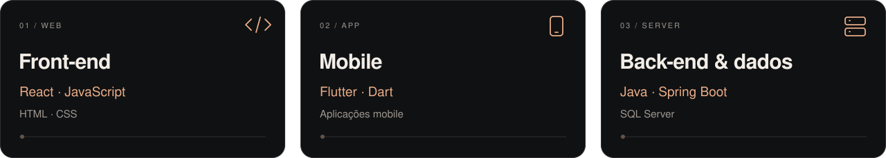
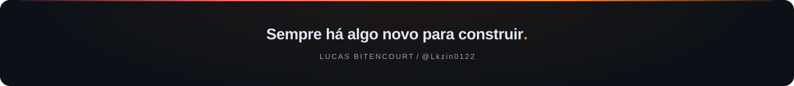

  

 

  
  &nbsp;
  

 

  <a href="#sobre-mim">Sobre mim</a>
  &nbsp; / &nbsp;
  <a href="#minha-stack">Stack</a>
  &nbsp; / &nbsp;
  <a href="#código-em-movimento">Atividade</a>
  &nbsp; / &nbsp;
  <a href="#vamos-conversar">Contato</a>

 

## Sobre mim

Sou **Lucas Bitencourt**, desenvolvedor com foco em **front-end**. Gosto de transformar ideias em interfaces que unem cuidado visual, simplicidade e uma boa experiência — na **web e no mobile**.

- **Formação** &nbsp; Técnico em Informática pela **FIEB** e cursando **Análise e Desenvolvimento de Sistemas**.
- **Na prática** &nbsp; Aplicações com **React e Flutter**, além de experiência com **Java e Spring Boot**.
- **Minha base** &nbsp; Lógica de programação, orientação a objetos e vontade de aprender construindo.

> Cada projeto é uma oportunidade de fazer melhor que ontem.

 

## Minha stack

As tecnologias que uso para conectar uma ideia à experiência de quem está do outro lado da tela.

  
    
  
  &nbsp;
  
  &nbsp;
  

 

## Código em movimento

Um registro do que venho construindo, uma contribuição de cada vez.

  
    
  Pequenos passos, progresso constante. Atualizado diariamente.

 

## Vamos conversar

Tem uma ideia, um projeto ou quer trocar experiências sobre desenvolvimento? Me encontre no **[LinkedIn](https://www.linkedin.com/in/bitencourtlucas/)**.

Você também pode explorar o que estou construindo nos meus **[repositórios](https://github.com/Lkzin0122?tab=repositories)**.

 

